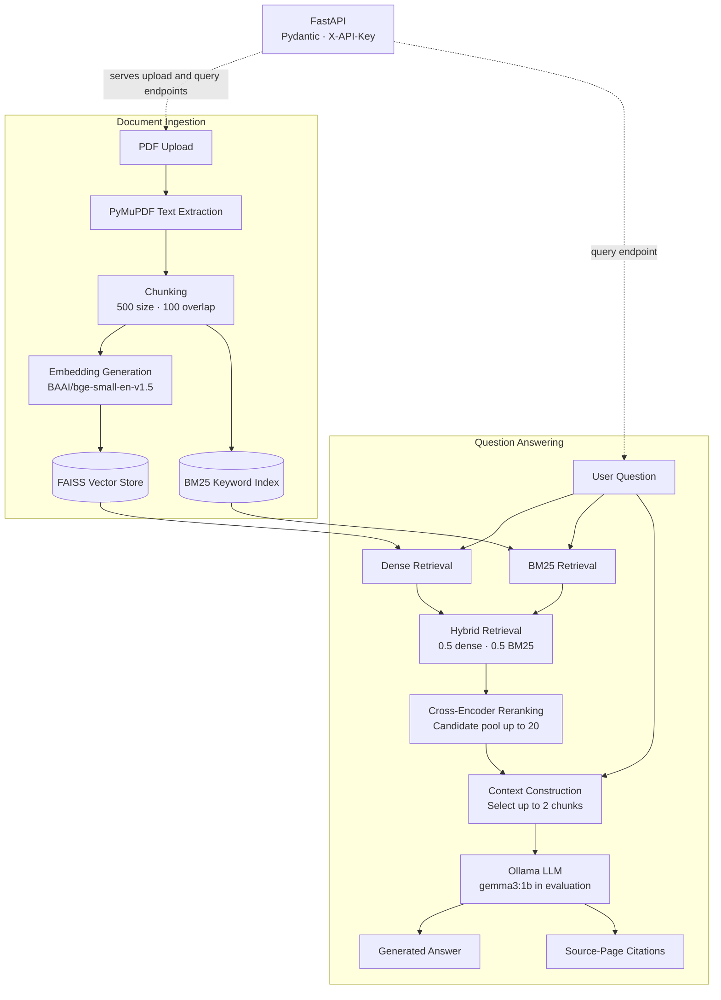

# DocumentAssistant

A hybrid Retrieval-Augmented Generation (RAG) system for asking questions about PDF documents. It combines dense semantic retrieval, BM25 keyword search, hybrid retrieval, cross-encoder reranking, and an Ollama-served language model. Answers include source-page citations so users can inspect the retrieved evidence.

**Demo recording:** https://drive.google.com/file/d/1SDwwv8QN2i2M4LrxhQEZVnw2HIb2PG2L/view?usp=sharing


## Features

- PDF upload and text extraction with PyMuPDF
- Configurable text chunking with overlap
- Dense semantic retrieval using FAISS
- Keyword retrieval using BM25
- Hybrid retrieval combining dense and lexical search
- Cross-encoder reranking
- Answer generation through Ollama
- Source-page citations and retrieved passage details
- FastAPI endpoints with Pydantic request and response validation
- API-key authentication for upload and query endpoints
- Docker and Docker Compose support
- Custom evaluation script and 20-question test set
- Deployed and smoke-tested on AWS EC2

> **Frontend status:** `app/ui.py` is a Streamlit prototype that currently runs the RAG pipeline directly. It has not yet been connected to the FastAPI endpoints. The API can be used independently through Swagger UI, curl, or another client.

## Architecture

The diagram below shows document ingestion, retrieval, answer generation, and citation output. The Streamlit prototype is separate from the FastAPI API at this stage.



## Tech Stack

| Component | Technology |
|---|---|
| Language | Python |
| API framework | FastAPI |
| Data validation | Pydantic |
| RAG framework | LangChain |
| PDF processing | PyMuPDF |
| Embeddings | `BAAI/bge-small-en-v1.5` |
| Vector search | FAISS |
| Lexical retrieval | BM25 |
| Reranking | `cross-encoder/ms-marco-MiniLM-L-6-v2` |
| LLM runtime | Ollama |
| Model used in latest evaluation | `gemma3:1b` |
| Containerization | Docker, Docker Compose |
| Deployment | AWS EC2 |
| Evaluation | Custom Python evaluation script |

## Project Structure

```text
DocumentAssistant/
├── app/
│   ├── __init__.py
│   ├── api.py
│   ├── config.py
│   ├── hybrid_retriever.py
│   ├── pdf_utils.py
│   ├── rag_pipeline.py
│   ├── reranker.py
│   ├── ui.py
│   └── vector_store.py
├── docs/                   # Demo recording and screenshots
├── evaluation/
│   ├── evaluate.py
│   ├── test_cases.json
│   ├── README.md
│   └── results/
├── .dockerignore
├── .env.example
├── .gitignore
├── compose.yaml
├── Dockerfile
├── requirements.txt
└── README.md
```

Runtime data such as uploaded PDFs and generated FAISS indexes is created locally and should not be committed.

## How It Works

### 1. PDF processing

PyMuPDF extracts text from uploaded PDFs. Source-page metadata is retained so retrieved passages can be traced back to their original pages.

### 2. Chunking

The extracted text is split into overlapping chunks.

- **Chunk size:** 500
- **Chunk overlap:** 100

### 3. Embeddings and vector search

`BAAI/bge-small-en-v1.5` converts chunks into vector representations. FAISS indexes these vectors and retrieves semantically relevant passages for a question.

### 4. Lexical retrieval

BM25 retrieves passages based on keyword relevance. This can help when a question contains specific terms, names, or phrases.

### 5. Hybrid retrieval

Dense retrieval and BM25 provide complementary retrieval signals. The current configured weights are:

- **Dense retrieval:** 0.5
- **BM25 retrieval:** 0.5

### 6. Reranking

The cross-encoder evaluates the question and candidate passages together, then reranks them by relevance. The current pipeline uses a candidate pool of up to 20 chunks and selects up to 2 chunks for final context.

### 7. Answer generation

The selected context and user question are passed to the configured language model through Ollama.

### 8. Source citations

The API returns the generated answer alongside source metadata, including available filenames, page numbers, chunk identifiers, and retrieved passage content.

## API Documentation

When the API is running locally:

- Swagger UI: `http://localhost:8000/docs`
- ReDoc: `http://localhost:8000/redoc`

| Method | Endpoint | Purpose | Authentication |
|---|---|---|---|
| `GET` | `/health` | Check API health and model configuration | No API key |
| `POST` | `/upload` | Upload and process a PDF | `X-API-Key` required |
| `POST` | `/query` | Ask a question about the active PDF | `X-API-Key` required |

### Health check

```bash
curl http://localhost:8000/health
```

A healthy response confirms that the API process responds. It does not, by itself, prove that model inference and the full RAG pipeline are working.

### Upload a PDF

```bash
curl -X POST "http://localhost:8000/upload" \
  -H "X-API-Key: YOUR_API_KEY" \
  -F "file=@document.pdf"
```

The response includes a message, filename, document ID, and number of chunks created. The API accepts PDF uploads up to 20 MB.

### Ask a question

```bash
curl -X POST "http://localhost:8000/query" \
  -H "X-API-Key: YOUR_API_KEY" \
  -H "Content-Type: application/json" \
  -d '{"question":"Summarize the main ideas in the document."}'
```

The response includes the question, generated answer, and source objects. For the exact response schema, inspect `/docs` while the API is running.

## Demo

The `docs/` directory contains the project demo recording and screenshots. Add the final filenames or links below once you have checked them for secrets and private information.

Suggested screenshot list:

- API documentation (Swagger UI)
- API health check
- Successful PDF upload
- Question with cited source passages

Do not add image links until the corresponding image files exist at those paths. Before publishing, inspect every screenshot and recording for API keys, credentials, AWS account identifiers, private IPs, or other sensitive information.

## Local Setup

### Prerequisites

- Python 3.12
- Git
- Ollama
- Docker (optional, for the containerized setup)

### 1. Clone the repository

After creating the GitHub repository, replace the URL below with its clone URL:

```bash
git clone https://github.com/YOUR_USERNAME/DocumentAssistant.git
cd DocumentAssistant
```

### 2. Create and activate a virtual environment

**Windows PowerShell:**

```powershell
python -m venv venv
.\venv\Scripts\Activate.ps1
```

**macOS/Linux:**

```bash
python3 -m venv venv
source venv/bin/activate
```

### 3. Install dependencies

```bash
python -m pip install --upgrade pip
pip install -r requirements.txt
```

### 4. Configure environment variables

Create a local `.env` file using `.env.example` as a reference. Set a strong, private API key:

```dotenv
DOCUMENTASSISTANT_API_KEY=replace_with_your_private_key
```

Never commit `.env` or publish its contents. The API reads the key from the `DOCUMENTASSISTANT_API_KEY` environment variable.

### 5. Start Ollama

Pull the default model configured for the local setup:

```bash
ollama pull gemma3:1b
```

Make sure the Ollama service is running. The default local configuration is:

```dotenv
LLM_MODEL=gemma3:1b
OLLAMA_BASE_URL=http://localhost:11434
```

If `.env.example` specifies different values, follow the configuration used by the checked-out code.

### 6. Start the API

From the project root:

```bash
uvicorn api:app --app-dir app --host 127.0.0.1 --port 8000
```

Open `http://localhost:8000/docs` to explore and test the endpoints.

### 7. Run the Streamlit prototype (optional)

The Streamlit UI currently invokes the RAG pipeline directly rather than calling FastAPI. Run it in a separate terminal after installing dependencies:

```bash
streamlit run app/ui.py
```

This prototype may require the same local model and environment configuration as the RAG pipeline.

## Run with Docker

Build the image:

```bash
docker build -t documentassistant .
```

Ensure a local `.env` file exists with the required API key, then start the application:

```bash
docker compose up --build -d
```

Useful commands:

```bash
docker compose ps
docker compose logs -f documentassistant
docker compose down
```

The Compose configuration uses `host.docker.internal` to connect to Ollama running on the host in supported local Docker environments. The configured Ollama endpoint must be reachable from inside the container. For EC2, ensure the model service and its endpoint are configured for that environment.

## Deployment on AWS EC2

The Dockerized API has been deployed to AWS EC2 in the `eu-north-1` (Stockholm) region and smoke-tested through its public endpoint.

- **Container image:** `prishaaasingh/documentassistant:latest`
- **Port:** `8000`
- **Tested workflows:** health check, PDF upload, question answering, and source citations
- **Secrets:** API keys are supplied through environment variables, not embedded in the image or source code.

The exact instance type and model-serving configuration should be confirmed from the current AWS setup before documenting them. Do not publish instance identifiers, public IP addresses, account IDs, or credentials in this README.

For a public deployment, restrict inbound access to the required ports and trusted sources. Stop or terminate resources when they are not needed, and check AWS billing and resource usage regularly.

## Evaluation

The project includes a custom evaluation workflow in `evaluation/` with 20 question-answer test cases.

Run the evaluation from the project root:

```bash
python evaluation/evaluate.py --pdf "data/raw_pdfs/RAG_Testing.pdf"
```

The test PDF is a local evaluation asset and should remain untracked unless you have confirmed that you have permission to publish it.

### Results

The evaluation was run on October 22, 2026, using 20 question-answer test cases against `RAG_Testing.pdf`. The recorded run used the `gemma3:1b` Ollama model.

| Metric | Result |
|---|---:|
| Test cases | 20 |
| Successful runs | 20/20 |
| Failed runs | 0 |
| Expected-page hit rate | 100% |
| Mean retrieved-context answer lexical overlap | 60.94% |
| Mean generated-answer lexical overlap | 35.99% |
| Mean recorded latency | 10.74 seconds |

### How to interpret these results

- **Expected-page hit rate** measures whether at least one manually specified expected page appeared among the returned source pages. It is a retrieval metric, not a measure of answer correctness.
- **Lexical overlap** measures word overlap against reference answers. It is a diagnostic measure and does not establish semantic correctness or faithfulness.
- **Mean latency** is the average time recorded per evaluation run in this test environment.

These results apply to the tested document, questions, model, and environment. The test set is small and custom-authored; the results do not establish general answer accuracy or production-level performance.

### Limitations observed

The current evaluation uses lexical diagnostics rather than a full semantic or faithfulness evaluation. Generated answers should be manually checked against their cited passages. Additional tests should cover reworded questions, multi-page answers, and questions whose answers are absent from the PDF.

## Security Considerations

- API keys are read from environment variables.
- `.env` should remain excluded from Git.
- PDFs and generated vector-store data should not be committed unless explicitly approved for publication.
- Do not expose API keys in logs, screenshots, videos, or public repositories.
- Restrict public access to API endpoints and use HTTPS and stronger authentication controls for production deployments.
- Treat uploaded documents as potentially sensitive.

## Limitations

- Answer quality depends on document quality, chunking, retrieval, and model behavior.
- Inference speed depends on available compute resources and model configuration.
- Scanned PDFs may require OCR if they contain no extractable text.
- Retrieved context may omit information needed for complex or multi-hop questions.
- Generated answers may be incomplete or incorrect and should be checked against source passages.
- A healthy API response does not guarantee successful model inference.
- The API currently maintains one active document in process memory; uploading another document replaces the active assistant for subsequent queries.
- The project is a portfolio implementation and needs additional security, reliability, multi-user state management, and evaluation work before production use.

## Future Improvements

- Connect the Streamlit prototype to the FastAPI endpoints.
- Add persistent document and query metadata storage.
- Implement user authentication and authorization.
- Expand automated retrieval and answer-quality evaluation.
- Improve document management and multi-document retrieval.
- Add deployment automation and continuous integration.
- Improve observability, error handling, and monitoring.

## Author

**Prisha Singh**
B.Tech, Computer Science and Engineering (Data Science), BPIT

GitHub: https://github.com/prisha811

