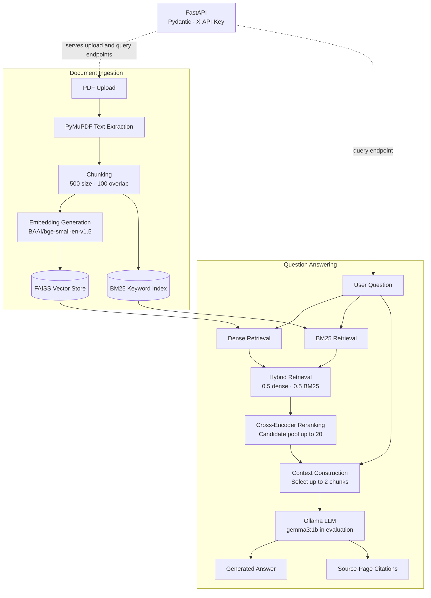

# DocumentAssistant

A hybrid Retrieval-Augmented Generation (RAG) system for asking questions about PDF documents. It combines dense semantic retrieval, BM25 keyword search, hybrid retrieval, cross-encoder reranking, and an Ollama-served language model. Answers include source-page citations so users can inspect the retrieved evidence.

**Demo recording:** https://drive.google.com/file/d/1SDwwv8QN2i2M4LrxhQEZVnw2HIb2PG2L/view?usp=sharing


## Features

- PDF upload and text extraction with PyMuPDF
- Configurable text chunking with overlap
- Dense semantic retrieval using FAISS
- Keyword retrieval using BM25
- Hybrid retrieval combining dense and lexical search
- Cross-encoder reranking
- Answer generation through Ollama
- Source-page citations and retrieved passage details
- FastAPI endpoints with Pydantic request and response validation
- API-key authentication for upload and query endpoints
- Docker and Docker Compose support
- Custom evaluation script and 20-question test set
- Deployed and smoke-tested on AWS EC2

> **Frontend status:** `app/ui.py` is a Streamlit prototype that currently runs the RAG pipeline directly. It has not yet been connected to the FastAPI endpoints. The API can be used independently through Swagger UI, curl, or another client.

## Architecture

The diagram below shows document ingestion, retrieval, answer generation, and citation output. The Streamlit prototype is separate from the FastAPI API at this stage.



## Tech Stack

| Component | Technology |
|---|---|
| Language | Python |
| API framework | FastAPI |
| Data validation | Pydantic |
| RAG framework | LangChain |
| PDF processing | PyMuPDF |
| Embeddings | `BAAI/bge-small-en-v1.5` |
| Vector search | FAISS |
| Lexical retrieval | BM25 |
| Reranking | `cross-encoder/ms-marco-MiniLM-L-6-v2` |
| LLM runtime | Ollama |
| Model used in latest evaluation | `gemma3:1b` |
| Containerization | Docker, Docker Compose |
| Deployment | AWS EC2 |
| Evaluation | Custom Python evaluation script |

## Project Structure

```text
DocumentAssistant/
├── app/
│   ├── __init__.py
│   ├── api.py
│   ├── config.py
│   ├── hybrid_retriever.py
│   ├── pdf_utils.py
│   ├── rag_pipeline.py
│   ├── reranker.py
│   ├── ui.py
│   └── vector_store.py
├── docs/                   # Demo recording and screenshots
├── evaluation/
│   ├── evaluate.py
│   ├── test_cases.json
│   ├── README.md
│   └── results/
├── .dockerignore
├── .env.example
├── .gitignore
├── compose.yaml
├── Dockerfile
├── requirements.txt
└── README.md
```

Runtime data such as uploaded PDFs and generated FAISS indexes is created locally and should not be committed.

## How It Works

### 1. PDF processing

PyMuPDF extracts text from uploaded PDFs. Source-page metadata is retained so retrieved passages can be traced back to their original pages.

### 2. Chunking

The extracted text is split into overlapping chunks.

- **Chunk size:** 500
- **Chunk overlap:** 100

### 3. Embeddings and vector search

`BAAI/bge-small-en-v1.5` converts chunks into vector representations. FAISS indexes these vectors and retrieves semantically relevant passages for a question.

### 4. Lexical retrieval

BM25 retrieves passages based on keyword relevance. This can help when a question contains specific terms, names, or phrases.

### 5. Hybrid retrieval

Dense retrieval and BM25 provide complementary retrieval signals. The current configured weights are:

- **Dense retrieval:** 0.5
- **BM25 retrieval:** 0.5

### 6. Reranking

The cross-encoder evaluates the question and candidate passages together, then reranks them by relevance. The current pipeline uses a candidate pool of up to 20 chunks and selects up to 2 chunks for final context.

### 7. Answer generation

The selected context and user question are passed to the configured language model through Ollama.

### 8. Source citations

The API returns the generated answer alongside source metadata, including available filenames, page numbers, chunk identifiers, and retrieved passage content.

## API Documentation

When the API is running locally:

- Swagger UI: `http://localhost:8000/docs`
- ReDoc: `http://localhost:8000/redoc`

| Method | Endpoint | Purpose | Authentication |
|---|---|---|---|
| `GET` | `/health` | Check API health and model configuration | No API key |
| `POST` | `/upload` | Upload and process a PDF | `X-API-Key` required |
| `POST` | `/query` | Ask a question about the active PDF | `X-API-Key` required |

### Health check

```bash
curl http://localhost:8000/health
```

A healthy response confirms that the API process responds. It does not, by itself, prove that model inference and the full RAG pipeline are working.

### Upload a PDF

```bash
curl -X POST "http://localhost:8000/upload" \
  -H "X-API-Key: YOUR_API_KEY" \
  -F "file=@document.pdf"
```

The response includes a message, filename, document ID, and number of chunks created. The API accepts PDF uploads up to 20 MB.

### Ask a question

```bash
curl -X POST "http://localhost:8000/query" \
  -H "X-API-Key: YOUR_API_KEY" \
  -H "Content-Type: application/json" \
  -d '{"question":"Summarize the main ideas in the document."}'
```

The response includes the question, generated answer, and source objects. For the exact response schema, inspect `/docs` while the API is running.

## Demo

The `docs/` directory contains the project demo recording and screenshots. Add the final filenames or links below once you have checked them for secrets and private information.

Suggested screenshot list:

- API documentation (Swagger UI)
- API health check
- Successful PDF upload
- Question with cited source passages

Do not add image links until the corresponding image files exist at those paths. Before publishing, inspect every screenshot and recording for API keys, credentials, AWS account identifiers, private IPs, or other sensitive information.

## Local Setup

### Prerequisites

- Python 3.12
- Git
- Ollama
- Docker (optional, for the containerized setup)

### 1. Clone the repository

git clone https://github.com/YOUR_USERNAME/DocumentAssistant.git
cd DocumentAssistant
```

### 2. Create and activate a virtual environment

**Windows PowerShell:**

```powershell
python -m venv venv
.\venv\Scripts\Activate.ps1
```

**macOS/Linux:**

```bash
python3 -m venv venv
source venv/bin/activate
```

### 3. Install dependencies

```bash
python -m pip install --upgrade pip
pip install -r requirements.txt
```

### 4. Configure environment variables

Create a local `.env` file using `.env.example` as a reference. Set a strong, private API key:

```dotenv
DOCUMENTASSISTANT_API_KEY=replace_with_your_private_key
```

Never commit `.env` or publish its contents. The API reads the key from the `DOCUMENTASSISTANT_API_KEY` environment variable.

### 5. Start Ollama

Pull the default model configured for the local setup:

```bash
ollama pull gemma3:1b
```

Make sure the Ollama service is running. The default local configuration is:

```dotenv
LLM_MODEL=gemma3:1b
OLLAMA_BASE_URL=http://localhost:11434
```

If `.env.example` specifies different values, follow the configuration used by the checked-out code.

### 6. Start the API

From the project root:

```bash
uvicorn api:app --app-dir app --host 127.0.0.1 --port 8000
```

Why is hybrid retrieval useful?

Compare BM25 and dense retrieval.

Why is reranking required?

What are the limitations discussed in the document?

The quality of the answer depends on the uploaded document and the retrieved context.

🎯 Why Hybrid Retrieval?

A major design choice in this project is combining semantic and lexical retrieval.

Dense retrieval

FAISS uses embeddings to find passages that are semantically similar to the query.

Lexical retrieval

BM25 focuses on term-level matching.

Combined approach

                 User Query
                     │
          ┌──────────┴──────────┐
          ▼                     ▼
       FAISS                  BM25
   semantic search        lexical search
          │                     │
          └──────────┬──────────┘
                     ▼
                    RRF
                     ▼
              Cross-Encoder
                     ▼
              Best passages

This gives the system complementary semantic and lexical retrieval signals.

⚡ Performance Considerations

The generated FAISS index and chunk metadata are stored locally:

data/faiss_index/
    ├── index.faiss
    └── chunks.pkl

When the cached index exists, it can be loaded instead of regenerating the embeddings.

When a new PDF is uploaded, the Streamlit interface clears the previous PDF/index and rebuilds the knowledge base for the new document.

⚠️ Current Limitations

The application is designed around one uploaded PDF at a time.

Retrieval quality depends on chunking and embedding quality.

Local LLM response speed depends on available CPU/GPU/RAM.

Scanned/image-only PDFs require OCR support, which is not currently implemented.

Complex questions may still produce imperfect retrieval or generation.

The current system is a document QA application rather than a general-purpose chatbot.

🔮 Future Improvements

Multi-document retrieval

Query rewriting and query expansion

Metadata-aware retrieval

Improved chunking strategies

OCR for scanned PDFs

Streaming LLM responses

Advanced citation highlighting

Retrieval evaluation using Precision@k and Recall@k

Faithfulness/grounding evaluation

Persistent document collections

Better multi-hop question handling

📌 RAG Concepts Demonstrated

PDF Processing
      ↓
Chunking
      ↓
Embeddings
      ↓
Vector Search
      ↓
Lexical Search
      ↓
Hybrid Retrieval
      ↓
RRF
      ↓
Reranking
      ↓
Context Construction
      ↓
LLM Generation
      ↓
Source Attribution

👩‍💻 Author

Prisha Singh

B.Tech, Computer Science and Engineering (Data Science)